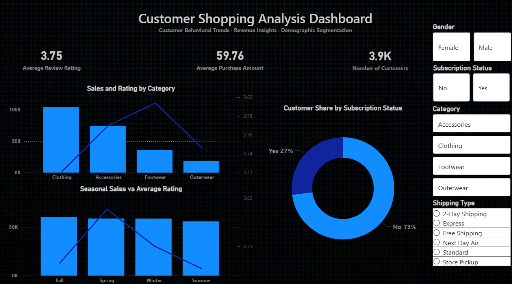

# 🛍 Customer Shopping Trends Analytics

A complete end-to-end data analytics project covering Python EDA, data cleaning, SQL-based insights, and a Power BI dashboard to uncover behavioral shopping patterns across demographics and purchasing trends.

This project demonstrates the full data lifecycle — from raw dataset to business insights and reporting.

This repo also includes a lightweight AI layer for business-question answering on top of the analytics dataset.

---

## 🖥️ Dashboard Preview

<div align="center">

</div>

---

## 📁 Project Structure

| Component | Output |
|----------|--------|
| Data Loading & Cleaning | Python (Jupyter Notebook) |
| Exploratory Data Analysis | Pandas, Seaborn |
| SQL Query-Based Analysis | PostgreSQL |
| AI Insights Layer | Python + Streamlit |
| Dashboard | Power BI |
| Report | PDF Documentation |
| Presentation | Business Deck |

---

## 📝 Files in This Repository

| File | Type | Purpose |
|------|------|--------|
| [customer_shopping_trends.ipynb](./customer_shopping_trends.ipynb) | 🐍 Jupyter Notebook | Python EDA + Cleaning + Visuals |
| [customer_trends_query_based_analysis.sql](./customer_trends_query_based_analysis.sql) | 🔍 SQL Queries | Revenue, subscriptions, categories, purchasing patterns |
| [customer_shopping_analysis_dashboard.pbix](./customer_shopping_analysis_dashboard.pbix) | 📊 Power BI Dashboard | Interactive dashboard |
| [Customer Shopping Trends Analytics Report.pdf](./Customer%20Shopping%20Trends%20Analytics%20Report.pdf) | 📄 PDF Report | Problem → Approach → Insights |
| [Customer-Shopping-Trends-Analytics.pptx](./Customer-Shopping-Trends-Analytics.pptx) | 📑 Presentation | Final business-ready deck |
| [customer_shopping_trends.csv](./customer_shopping_trends.csv) | 📁 Dataset | 4K+ customer transactions |
| [BlackNeonTheme.json](./BlackNeonTheme.json) | 🎨 Theme | Custom Power BI dark theme |
| [background img.jpg](./background%20img.jpg) | 🖼 UI Asset | Dashboard neon background |
| [app.py](./app.py) | 🤖 AI App | Lightweight business question interface |

---

## 🧾 Overview

This project analyzes over 4,000+ purchase records to derive insights into:

- 👨‍👩‍👧 Demographic influence on revenue  
- 🛍 Category-wise buying patterns  
- ⭐ Subscription vs non-subscription behavior  
- 🚚 Preferred shipping methods  
- ⭐ Review ratings and satisfaction  
- 💸 Average spend & repeat purchase patterns  

The AI layer adds a simple question-and-answer experience on top of these insights.

---

## 🗂 Dataset Features

| Feature | Description |
|--------|------------|
| Gender | Male / Female |
| Age Group | Senior / Adult / Young Adult |
| Category | Clothing, Accessories, Footwear |
| Subscription | Yes / No |
| Purchase Amount | Revenue Generated |
| Review Rating | Customer Feedback |
| Shipping Type | Free, Express, Standard |
| Previous Purchases | Repeat Customers |

📌 Source: Synthetic dataset created for analytics and educational demonstration.

---

## 🛠 Tools & Technologies

| Category | Tools |
|----------|------|
| Programming | Python |
| Analytics | Pandas, NumPy |
| SQL | PostgreSQL |
| Dashboard | Power BI |
| AI Layer | Streamlit, Python analytics |
| Reporting | PDF, PPT |
| Version Control | Git + GitHub |

---

## 🚀 Steps & Process

1️⃣ Import and explore the dataset  
2️⃣ Handle missing values, formatting, and cleaning  
3️⃣ Perform EDA with charts and summaries  
4️⃣ Run SQL queries for segmentation and revenue metrics  
5️⃣ Build interactive Power BI dashboard  
6️⃣ Add lightweight AI layer for business questions and summaries  
7️⃣ Generate report & presentation for stakeholders  

---

## 📊 Dashboard Preview

🔹 KPI cards: Total Customers, Avg Purchase Amount, Avg Rating  
🔹 Category & demographic revenue insights  
🔹 Subscription-based segmentation  
🔹 Shipping preference analytics  
🔹 Premium dark theme UI design  

📁 Dashboard File → `customer_shopping_analysis_dashboard.pbix`

---

## 🧠 Results & Key Insights

📌 Young Adults generate the highest revenue  
📌 Subscribed users spend higher & repeat more  
📌 Clothing category dominates sales  
📌 Standard & Free shipping preferred the most  
📌 Review ratings strongly correlate with purchase frequency  

These insights support business decisions in:

➡ Targeted marketing  
➡ Inventory forecasting  
➡ Subscription strategy  
➡ Shipping optimization  

---

## ▶ How to Run

### ▶ Run Python EDA
```bash
open: customer_shopping_trends.ipynb
```

### ▶ Run SQL Queries
```bash
open: customer_trends_query_based_analysis.sql
```

### ▶ Run the AI Layer
```bash
pip install -r requirements.txt
streamlit run app.py
```

### ▶ View Power BI Dashboard
```bash
open: customer_shopping_analysis_dashboard.pbix
```
